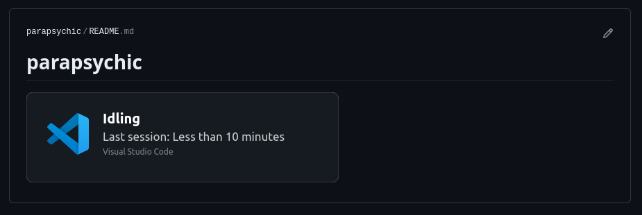

# IShowOff for Visual Studio Code Extension

The companion extension for [IShowOff](https://github.com/parapsychic/ishowoff).

This extension can automatically run a Github Action to display your editor session time on your Github profile like this:

## Setup 

1. Download the VS Code extension from the [marketplace](https://marketplace.visualstudio.com/items?itemName=parapsychic.ishowoff) or sideload this extension by building it and sideloading it.
2. Sign-in with Github when prompted.
3. The extension should auto-detect any forks of [IShowOff](https://github.com/parapsychic/ishowoff) repository. If it does not detect one, it will ask you for permission to automatically create a fork and use it.
4. Follow the steps inside the forked repo to show the image on your readme.

## Custom Commands
If you want to supply additional arguments or run different commands after running the rust binary to create svg file, you can use the custom commands section.

View full list of [arguments here](https://github.com/parapsychic/ishowoff). Some of them are set by the other setting fields and might get overwritten.

To run a entirely different command, use the [chaining operators](https://www.geeksforgeeks.org/chaining-commands-in-linux/) in Bash, assuming you did not change the actions to run on a different operating system.

## Known issues:
1. Editing config might trigger multiple timers and may send multiple rerun requests to github workflow. I'm working on a fix. (fixed ig?)
2. Opening different VSCode winddows/instances will trigger different timers and will keep on overwriting by calling the action on specified intervals. This is intended behaviour and can be stopped by calling ishowoff.disablePresence from the command palette on one of the instances.
3. You tell me. Open an issue.

Icon was made by Bing Chat. Please do let me know if it breaks any copyrights.

**Enjoy**
